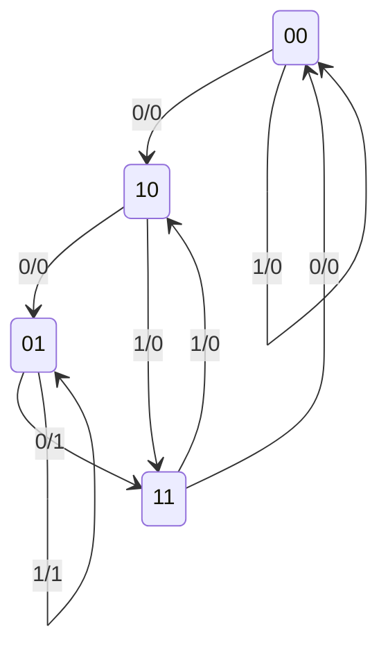

# 2008 春季期中考：題目

本頁依可辨識題面重寫為繁體中文，不是原始掃描或官方原文。考卷標題為 Digital System Design，Spring 2008 Midterm。保留第 1、2 題；第 3 題缺必要電路圖，列於末尾排除說明。

`!` 表示 NOT，乘積或 `·` 表示 AND，`+` 表示 OR。`A`、`B` 是目前狀態位元，`A⁺`、`B⁺` 是下一個狀態；使用 D 正反器時，其輸入分別為 `D_A=A⁺`、`D_B=B⁺`。

## 第 1 題：由方程式設計循序電路

電路使用兩個 D 正反器，狀態位元為 `A`、`B`，外部輸入為 `x`、`y`，輸出為 `z`。給定：

```text
A⁺ = !x·B + x·y
B⁺ = !x·A
z  = A·B
```

1. 畫出電路的邏輯接線圖，包含兩個 D 正反器、組合邏輯及回授。（5%）
2. 列出完整狀態表，包含目前狀態 `AB`、輸入 `xy`、下一狀態 `A⁺B⁺` 與輸出 `z`。（15%）

輸出式中的 `A`、`B` 是**目前**狀態，不能代入下一狀態。題面未指定 reset 或初始狀態；狀態表必須涵蓋四個目前狀態與四種輸入，共 16 列。

## 第 2 題：由狀態圖求激勵方程

電路有兩個狀態位元、一個 1-bit 輸入與一個 1-bit 輸出。將狀態圖中的兩位元由左至右記作 `AB`，輸入記作 `x`，輸出為 `z`；`D_A`、`D_B` 表示下一狀態位元。圖上每條邊的標籤為 `x/z`。

下面是原圖的完整八條邊，重新繪製並以文字表核對，沒有新增起始狀態：



| 目前狀態 AB | x | 下一狀態 | z |
|---|---|---|---|
| 00 | 0 | 10 | 0 |
| 00 | 1 | 00 | 0 |
| 01 | 0 | 11 | 1 |
| 01 | 1 | 01 | 1 |
| 10 | 0 | 01 | 0 |
| 10 | 1 | 11 | 0 |
| 11 | 0 | 00 | 0 |
| 11 | 1 | 10 | 0 |

1. 列出狀態表。（5%）
2. 畫出 `D_A`、`D_B` 及 `z` 的 Karnaugh maps，並從 maps 推導三個 Boolean 方程式。（15%）

圖中的八條邊涵蓋全部狀態及輸入，不使用 don't-care。狀態名稱與激勵名稱在本頁統一成上述記號，避免把目前狀態和 D 端輸入混在一起。

## 排除紀錄

可見的第 3 題是求循序電路的最短 clock period，必要的 Fig. 2 只剩局部方塊，正反器、接線及相關時脈資訊被裁掉。文字中的延遲數值無法唯一決定路徑，因此不重建其電路或答案，也不計入已完成題數。
