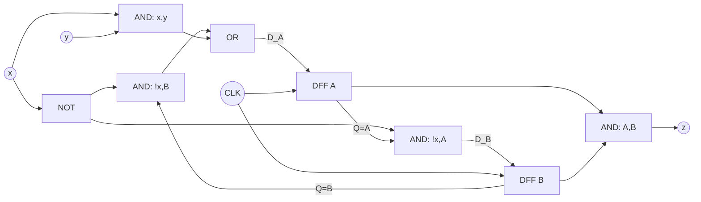

# 2008 春季期中考：完整解答

完整題面見 [questions.md](questions.md)。以下兩題均從可辨識原式與原狀態圖重新推導；附 RTL 與 Python 模型作可執行驗證。第 3 題缺圖，排除而不補造。

## 第 1 題

本題給定 `A⁺=!x·B+x·y`、`B⁺=!x·A`、`z=A·B`。D 正反器在有效 clock edge 後把 D 端值存成新的 Q，所以直接令 `D_A=A⁺`、`D_B=B⁺`。

### 邏輯圖與接線



精確接線為：

| 節點 | 驅動來源 | 用途 |
|---|---|---|
| `nx` | `NOT(x)` | 兩個 AND 共用反相 x |
| `p` | `AND(nx,B)` | A 的第一個乘積項 |
| `q` | `AND(x,y)` | A 的第二個乘積項 |
| `D_A` | `OR(p,q)` | 接 DFF A 的 D 端 |
| `D_B` | `AND(nx,A)` | 接 DFF B 的 D 端 |
| `z` | `AND(A,B)` | 直接讀取兩個 Q 輸出 |
| `A,B` | DFF A、DFF B 的 Q | 回授到上述組合邏輯 |

兩個正反器使用同一個 clock。原式不含 reset；圖中的主答案也不需要添加 reset。

### 完整狀態表

<!-- Q1_TABLE_BEGIN -->
| A | B | x | y | D_A | D_B | z |
|---|---|---|---|---|---|---|
| 0 | 0 | 0 | 0 | 0 | 0 | 0 |
| 0 | 0 | 0 | 1 | 0 | 0 | 0 |
| 0 | 0 | 1 | 0 | 0 | 0 | 0 |
| 0 | 0 | 1 | 1 | 1 | 0 | 0 |
| 0 | 1 | 0 | 0 | 1 | 0 | 0 |
| 0 | 1 | 0 | 1 | 1 | 0 | 0 |
| 0 | 1 | 1 | 0 | 0 | 0 | 0 |
| 0 | 1 | 1 | 1 | 1 | 0 | 0 |
| 1 | 0 | 0 | 0 | 0 | 1 | 0 |
| 1 | 0 | 0 | 1 | 0 | 1 | 0 |
| 1 | 0 | 1 | 0 | 0 | 0 | 0 |
| 1 | 0 | 1 | 1 | 1 | 0 | 0 |
| 1 | 1 | 0 | 0 | 1 | 1 | 1 |
| 1 | 1 | 0 | 1 | 1 | 1 | 1 |
| 1 | 1 | 1 | 0 | 0 | 0 | 1 |
| 1 | 1 | 1 | 1 | 1 | 0 | 1 |
<!-- Q1_TABLE_END -->

可把 16 列的下一狀態用兩個分支核對：`x=0` 時 `A⁺B⁺=BA`，不受 y 影響；`x=1` 時 `A⁺B⁺=y0`。`z` 完全不受 x、y 影響，當且僅當**目前** `AB=11` 時為 1。特別是 `AB=11, xy=10/11` 的兩列，雖然下一狀態不是 `11`，目前輸出仍是 1。

## 第 2 題

本題由圖讀出八條 `x/z` 邊。狀態順序按 `AB=00,01,10,11`，不能因圖形位置而交換 A、B。

### 狀態表

<!-- Q2_TABLE_BEGIN -->
| A | B | x | D_A | D_B | z |
|---|---|---|---|---|---|
| 0 | 0 | 0 | 1 | 0 | 0 |
| 0 | 0 | 1 | 0 | 0 | 0 |
| 0 | 1 | 0 | 1 | 1 | 1 |
| 0 | 1 | 1 | 0 | 1 | 1 |
| 1 | 0 | 0 | 0 | 1 | 0 |
| 1 | 0 | 1 | 1 | 1 | 0 |
| 1 | 1 | 0 | 0 | 0 | 0 |
| 1 | 1 | 1 | 1 | 0 | 0 |
<!-- Q2_TABLE_END -->

依 `A,B,x` 位元順序，三個 ON 集合為 `D_A=Σm(0,2,5,7)`、`D_B=Σm(2,3,4,5)`、`z=Σm(2,3)`。

### K-maps 與圈選

每個 map 的 row 為 A，column 為 Bx。column 必須用 Gray 順序 `00,01,11,10`，最左與最右欄相鄰。

`D_A`：

<!-- Q2_DA_MAP_BEGIN -->
| A / Bx | 00 | 01 | 11 | 10 |
|---|---|---|---|---|
| 0 | 1 | 0 | 0 | 1 |
| 1 | 0 | 1 | 1 | 0 |
<!-- Q2_DA_MAP_END -->

第一列左右兩個 1 跨邊界成一組，得到 `!A·!x`；第二列中間兩個 1 成一組，得到 `A·x`。因此：

```text
D_A = !A·!x + A·x = !(A XOR x)
```

`D_B`：

<!-- Q2_DB_MAP_BEGIN -->
| A / Bx | 00 | 01 | 11 | 10 |
|---|---|---|---|---|
| 0 | 0 | 0 | 1 | 1 |
| 1 | 1 | 1 | 0 | 0 |
<!-- Q2_DB_MAP_END -->

第一列右半成一組，得到 `!A·B`；第二列左半成一組，得到 `A·!B`。因此：

```text
D_B = !A·B + A·!B = A XOR B
```

`z`：

<!-- Q2_z_MAP_BEGIN -->
| A / Bx | 00 | 01 | 11 | 10 |
|---|---|---|---|---|
| 0 | 0 | 0 | 1 | 1 |
| 1 | 0 | 0 | 0 | 0 |
<!-- Q2_z_MAP_END -->

只有第一列右半為 1，圈成一組，所以：

```text
z = !A·B
```

三個結果中 x 分別被消去或保留的位置都可由狀態表直接核對：`D_A=1` 當且僅當 A=x，`D_B=1` 當且僅當 A≠B，輸出只在狀態 `01` 為 1。圖上雖把輸出寫在 edge label，兩條同狀態出邊的輸出相同，因此此圖的輸出可以由 Moore 型的狀態函數實作。

## 補充程式介面與驗證

原題要求紙上接線圖、狀態表及 maps，沒有要求 HDL。為便於實測，增加以下介面：

| 模組 | 輸入 | 輸出 | 行為 |
|---|---|---|---|
| `q1_next` | 1-bit A,B,x,y | 1-bit DA,DB,z | 第 1 題原式的組合邏輯 |
| `q2_next` | 1-bit A,B,x | 1-bit DA,DB,z | 第 2 題化簡式的組合邏輯 |
| `q1_seq` | clk,reset,x,y | A,B,z | 第 1 題搭配兩個 DFF |
| `q2_seq` | clk,reset,x | A,B,z | 第 2 題搭配兩個 DFF |

順序模組補定：clock 上升緣更新 A、B，使用 nonblocking assignment；`reset=1` 非同步清為 `00`。reset、初始狀態、clock edge 是這份可執行示範的約定，沒有加進原題的狀態表。任意目前狀態的 24 組組合均由 `q1_next`、`q2_next` 獨立核對，不因從 `00` 開始的可達性而省略某列。

`model.py` 是 Python 標準函式庫模型：第 1 題直接算原式，第 2 題以圖的八條邊查表，另有化簡式供交叉驗證；可印出本頁的小型表格與 maps。`tests/test_2008.py` 使用另外列出的完整狀態表作 oracle，驗證模型與文件，並枚舉所有三變數 implicants 求最少 SOP 項數與 literal 數。兩個激勵最少均為 2 項／4 literals，z 為 1 項／2 literals。

`tb.v` 對第 1 題全 16 組、第 2 題全 8 組輸入作 case-table 比較，另在合法狀態 `11` 核對第 1 題的目前狀態輸出，再檢查非同步 reset 與 64 個 clock cycles，總計 91 個檢查單位。短循環涵蓋第 2 題全部八條邊；不展開大量向量檔。預期通過摘要為 `PASS 2008: 91 checks`。測試不產生波形或 VCD，Icarus 的執行檔保存在暫存目錄並自動清除。僅 Python 模型通過時，不宣稱 RTL 已模擬；Linux CI 會執行 Icarus。

## 全部題解程式碼

下方完整收錄 RTL、testbench 與模型；各檔可直接依 README 命令執行。

<!-- SOLUTION_CODE_BEGIN -->

### `design.v`

```verilog
`timescale 1ns/1ps

// Q1: exact next-state/output equations, independent of clock/reset convention.
module q1_next(
    input wire A, B, x, y,
    output wire DA, DB, z
);
    assign DA = (~x & B) | (x & y);
    assign DB = ~x & A;
    assign z = A & B;
endmodule

// Optional executable illustration: rising clock edge, asynchronous active-high
// reset to 00. Reset was not specified by the paper's equations.
module q1_seq(
    input wire clk, reset, x, y,
    output reg A, B,
    output wire z
);
    wire DA, DB;
    q1_next logic_block(.A(A), .B(B), .x(x), .y(y),
                        .DA(DA), .DB(DB), .z(z));
    always @(posedge clk or posedge reset) begin
        if (reset) begin
            A <= 1'b0;
            B <= 1'b0;
        end else begin
            A <= DA;
            B <= DB;
        end
    end
endmodule

// Q2: minimized equations derived from the eight graph edges.
module q2_next(
    input wire A, B, x,
    output wire DA, DB, z
);
    assign DA = (~A & ~x) | (A & x);
    assign DB = (~A & B) | (A & ~B);
    assign z = ~A & B;
endmodule

module q2_seq(
    input wire clk, reset, x,
    output reg A, B,
    output wire z
);
    wire DA, DB;
    q2_next logic_block(.A(A), .B(B), .x(x), .DA(DA), .DB(DB), .z(z));
    always @(posedge clk or posedge reset) begin
        if (reset) begin
            A <= 1'b0;
            B <= 1'b0;
        end else begin
            A <= DA;
            B <= DB;
        end
    end
endmodule
```

### `tb.v`

```verilog
`timescale 1ns/1ps

module tb_2008;
    reg A1, B1, x1, y1;
    reg A2, B2, x2;
    wire DA1, DB1, z1, DA2, DB2, z2;
    reg clk, reset, sx, sy;
    wire QA1, QB1, sz1, QA2, QB2, sz2;
    reg [1:0] reference1, reference2, future1, future2;
    integer i, checks;

    q1_next c1(A1, B1, x1, y1, DA1, DB1, z1);
    q2_next c2(A2, B2, x2, DA2, DB2, z2);
    q1_seq s1(clk, reset, sx, sy, QA1, QB1, sz1);
    q2_seq s2(clk, reset, sx, QA2, QB2, sz2);

    // Independent reference: complete state table, not the DUT gate expression.
    function [1:0] expected1;
        input [3:0] key;
        begin
            case (key)
                0, 1, 2, 6, 10, 14: expected1 = 2'b00;
                3, 4, 5, 7, 11, 15: expected1 = 2'b10;
                8, 9: expected1 = 2'b01;
                12, 13: expected1 = 2'b11;
                default: expected1 = 2'bxx;
            endcase
        end
    endfunction

    // Independent reference: original state-diagram destination labels.
    function [1:0] expected2;
        input [2:0] key;
        begin
            case (key)
                0: expected2 = 2'b10;
                1: expected2 = 2'b00;
                2: expected2 = 2'b11;
                3: expected2 = 2'b01;
                4: expected2 = 2'b01;
                5: expected2 = 2'b11;
                6: expected2 = 2'b00;
                7: expected2 = 2'b10;
                default: expected2 = 2'bxx;
            endcase
        end
    endfunction

    initial begin
        checks = 0;
        clk = 0; reset = 0; sx = 0; sy = 0;
        A1 = 0; B1 = 0; x1 = 0; y1 = 0;
        A2 = 0; B2 = 0; x2 = 0;
        for (i = 0; i < 16; i = i + 1) begin
            {A1, B1, x1, y1} = i[3:0];
            #1;
            if ({DA1, DB1} !== expected1(i[3:0]))
                $fatal(1, "Q1 next-state mismatch, key=%0d", i);
            if (z1 !== (i >= 12))
                $fatal(1, "Q1 present-state output mismatch, key=%0d", i);
            checks = checks + 1;
        end
        for (i = 0; i < 8; i = i + 1) begin
            {A2, B2, x2} = i[2:0];
            #1;
            if ({DA2, DB2} !== expected2(i[2:0]))
                $fatal(1, "Q2 next-state mismatch, key=%0d", i);
            if (z2 !== ((i == 2) || (i == 3)))
                $fatal(1, "Q2 graph output mismatch, key=%0d", i);
            checks = checks + 1;
        end
        // State 11 is valid in the original uninitialized circuit, even though
        // reset-to-00 operation cannot reach it. Sample its present-state output.
        force s1.A = 1'b1;
        force s1.B = 1'b1;
        sx = 1; sy = 0;
        #1;
        if (sz1 !== 1'b1) $fatal(1, "Q1 state 11 output uses the wrong time index");
        release s1.A;
        release s1.B;
        checks = checks + 1;
        // Reset occurs away from a rising clock edge.
        reset = 1;
        #1;
        if ({QA1, QB1, QA2, QB2} !== 4'b0000)
            $fatal(1, "Asynchronous reset did not clear both states");
        checks = checks + 1;
        reset = 0;
        reference1 = 0; reference2 = 0;
        for (i = 0; i < 64; i = i + 1) begin
            // This short repeating path traverses all eight Q2 graph edges.
            case (i % 12)
                3, 4, 6, 9: sx = 1;
                default: sx = 0;
            endcase
            sy = i[1] ^ i[3];
            future1 = expected1({reference1, sx, sy});
            future2 = expected2({reference2, sx});
            #2; clk = 1; #1;
            reference1 = future1;
            reference2 = future2;
            if ({QA1, QB1} !== reference1 || {QA2, QB2} !== reference2)
                $fatal(1, "Sequential next-state mismatch, cycle=%0d", i);
            if (sz1 !== (reference1 == 2'b11) || sz2 !== (reference2 == 2'b01))
                $fatal(1, "Sequential Moore output mismatch, cycle=%0d", i);
            checks = checks + 1;
            #2; clk = 0;
        end
        #1; reset = 1; #1;
        if ({QA1, QB1, QA2, QB2} !== 4'b0000 || sz1 !== 1'b0 || sz2 !== 1'b0)
            $fatal(1, "Reset after active operation failed");
        checks = checks + 1;
        $display("PASS 2008: %0d checks", checks);
        $finish;
    end
endmodule
```

### `model.py`

```python
"""2008 midterm Q1/Q2: executable tables and Gray-ordered Karnaugh maps."""
import itertools


def _validate(state, *bits):
    if state not in range(4) or any(bit not in (0, 1) for bit in bits):
        raise ValueError("state must be 0..3 and inputs must be bits")


def q1_transition(state, x, y):
    """Implement the original Q1 next-state/output equations."""
    _validate(state, x, y)
    a, b = state >> 1, state & 1
    da = ((1 - x) & b) | (x & y)
    db = (1 - x) & a
    return (da << 1) | db, a & b


Q2_GRAPH = {
    (0b00, 0): (0b10, 0), (0b00, 1): (0b00, 0),
    (0b01, 0): (0b11, 1), (0b01, 1): (0b01, 1),
    (0b10, 0): (0b01, 0), (0b10, 1): (0b11, 0),
    (0b11, 0): (0b00, 0), (0b11, 1): (0b10, 0),
}


def q2_transition(state, x):
    """Read the original eight directed edges; no Boolean minimizer involved."""
    _validate(state, x)
    return Q2_GRAPH[state, x]


def q2_equations(state, x):
    """Separate minimized implementation, to compare against the graph."""
    _validate(state, x)
    a, b = state >> 1, state & 1
    da = ((1 - a) & (1 - x)) | (a & x)
    db = ((1 - a) & b) | (a & (1 - b))
    return (da << 1) | db, (1 - a) & b


def q1_table():
    rows = []
    for a, b, x, y in itertools.product((0, 1), repeat=4):
        future, z = q1_transition((a << 1) | b, x, y)
        rows.append((a, b, x, y, future >> 1, future & 1, z))
    return rows


def q2_table():
    rows = []
    for a, b, x in itertools.product((0, 1), repeat=3):
        future, z = q2_transition((a << 1) | b, x)
        rows.append((a, b, x, future >> 1, future & 1, z))
    return rows


def q2_kmaps():
    """Rows A=0,1; columns Bx=00,01,11,10 (Gray order)."""
    maps = {"DA": [], "DB": [], "z": []}
    for a in (0, 1):
        values = {name: [] for name in maps}
        for b, x in ((0, 0), (0, 1), (1, 1), (1, 0)):
            future, z = q2_transition((a << 1) | b, x)
            for name, value in zip(("DA", "DB", "z"), (future >> 1, future & 1, z)):
                values[name].append(value)
        for name in maps:
            maps[name].append(values[name])
    return maps


def markdown_table(headers, rows):
    lines = ["| " + " | ".join(headers) + " |", "|" + "---|" * len(headers)]
    lines += ["| " + " | ".join(map(str, row)) + " |" for row in rows]
    return "\n".join(lines)


if __name__ == "__main__":
    print("Q1")
    print(markdown_table(("A", "B", "x", "y", "DA", "DB", "z"), q1_table()))
    print("\nQ2")
    print(markdown_table(("A", "B", "x", "DA", "DB", "z"), q2_table()))
    for name, values in q2_kmaps().items():
        print("\nK-map", name)
        print(markdown_table(("A / Bx", "00", "01", "11", "10"),
                             [[a, *row] for a, row in enumerate(values)]))
```

<!-- SOLUTION_CODE_END -->
