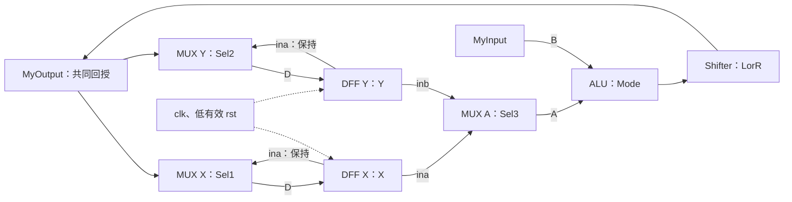

# 2009 數位系統設計期末考：重寫題目

此題面依提供的正式考卷與可辨識參考解答重新整理，共五大題、九個作答項目。原卷標示 Spring 2009，但日期欄使用另一年度的民國數字；本儲存庫依檔案年份及 Spring 2009 分類，不推測實際施測日期。原卷總分 105 分，各題配分完整保留。

所有內容以繁中改寫，電路以文字／Mermaid 描述，原波形必要規則以短時序表整理；不收錄原掃描、波形圖、姓名、學號或其他作者原始檔。補定的選擇器極性、reset 極性與模擬初始化會明確標示，不能把它們誤認為原卷已指定的條件。

## 第 1 題：修正 Verilog 錯誤（15 分）

找出並修正下列程式的宣告、指定及組合邏輯問題，保留原式描述的邏輯功能：

```verilog
module CheerUp(AndYou, IamFine, VeryGood, NotBad, Sel);
    output [1:0] IamFine, AndYou;
    input [1:0] VeryGood, NotBad;
    reg [1:0] VeryGood, NotBad;
    input Sel;
    reg [1:0] IamFine;

    AndYou = VeryGood | NotBad;

    always @(Sel or VeryGood)
        IamFine[0] = Sel ? VeryGood[0] : VeryGood[1];
        IamFine[1] = Sel ? NotBad[0] : NotBad[1];
endmodule
```

功能要求：`AndYou` 為 VeryGood 與 NotBad 的逐位 OR。Sel=1 時，IamFine 的 bit 0、bit 1 分別取得 VeryGood[0]、NotBad[0]；Sel=0 時分別取得 VeryGood[1]、NotBad[1]。

## 第 2 題：判斷所推導的硬體並畫符號（共 10 分）

分別判斷以下程式會推導什麼硬體，並標示資料輸入、使能與輸出：

### (a)

```verilog
reg outsig;
always @(en or ina)
    if (en) outsig = ina;
```

### (b)

```verilog
reg outsig;
always @(en or ina)
    if (en) outsig = ina;
    else outsig = 1'bz;
```

ina、en、outsig 都是一個位元。請區分「未指定時保留舊值」與「未使能時輸出高阻抗 Z」；不要單憑 `reg` 宣告就判斷為時脈觸發器。

## 第 3 題：撰寫四個 16 位元模組（共 45 分）

### (a) 2-to-1 multiplexer（10 分）

完成 `module MUX21(ina, inb, sel, out);`，ina、inb、out 各為 16 位元，sel 為一位元。

原卷沒有標示選擇器極性。本儲存庫依可辨識參考寫法補定 `sel=1 → out=ina`，`sel=0 → out=inb`，後續接線與波形均採同一慣例。

### (b) D flip-flop（10 分）

完成 `module DFF16(Q, D, clk, rst);`，D、Q 為 16 位元，在 clk 上升緣擷取資料，具有非同步 reset。

原卷沒有指定 reset 的有效極性或重設值。本儲存庫補定 rst=0 有效，非同步將 Q 清為 `16'h0000`；rst=1 時在 clk 上升緣令 Q 取得 D。

### (c) 邏輯位移器（10 分）

完成 `module Shifter(ShOut, C, LR);`，C、ShOut 為 16 位元，LR 為一位元。**實作不得使用 `<<` 或 `>>` 運算符**。

| LR | ShOut | 說明 |
|---:|---|---|
| 0 | C 右移一位 | bit 15 補 0，原 bit 0 丟棄 |
| 1 | C 左移一位 | bit 0 補 0，原 bit 15 丟棄 |

### (d) 算術邏輯單元（15 分）

完成 `module ALU(ALUOut, A, B, CTR);`。A、B、ALUOut 各 16 位元，CTR 為兩位元：

| CTR | 功能 | ALUOut |
|---:|---|---|
| 0 | 加法 | A+B |
| 1 | 減法 | A−B |
| 2 | 加一 | A+1 |
| 3 | 減一 | A−1 |

補定輸出只保留低 16 位，即 modulo 65536；不輸出 carry、borrow 或 overflow flag。位移是邏輯位移，不保留符號位。

## 第 4 題：連接資料路徑 MyDesign（20 分）

使用第 3 題的模組，連成下圖。原卷文字引用「Question 2」，但圖中的 MUX、DFF、ALU、Shifter 實際對應第 3 題，這裡修正交叉引用。所有資料線為 16 位元；選擇器控制一位元，Mode 為兩位元。



接線清單使圖中每個選擇分支可完整核對：

| 元件 | ina／D／A | inb／B | 控制 | 輸出 |
|---|---|---|---|---|
| MUX X | X | MyOutput | Sel1 | D_X |
| MUX Y | Y | MyOutput | Sel2 | D_Y |
| DFF X | D_X | — | clk、rst | X |
| DFF Y | D_Y | — | clk、rst | Y |
| MUX A | X | Y | Sel3 | A |
| ALU | A | MyInput | Mode | ALU result |
| Shifter | ALU result | — | LorR | MyOutput |

依本版選擇慣例：Sel1／Sel2 為 1 時各自保留原暫存器值，為 0 時於下一上升緣載入 MyOutput；Sel3=1 選 X，=0 選 Y。

## 第 5 題：依波形撰寫 testbench（15 分）

對第 4 題 MyDesign 撰寫 testbench，clock 的週期是 20 ns，0–10 ns 為高、10–20 ns 為低，每 20 ns 重複。原圖完整的五段輸入是：

| 時間區間 (ns) | Sel1 | Sel2 | Sel3 | LorR | Mode | MyInput |
|---|---:|---:|---:|---:|---|---|
| [0,20) | 0 | 1 | 1 | 0 | 2'b00 | 16'h001a |
| [20,40) | 1 | 1 | 1 | 0 | 2'b00 | 16'h00ea |
| [40,60) | 1 | 0 | 0 | 0 | 2'b01 | 16'h0055 |
| [60,80) | 0 | 0 | 0 | 1 | 2'b10 | 16'h008c |
| [80,100) | 0 | 0 | 0 | 1 | 2'b11 | 16'h00ff |

clock 上升邊界為 0、20、40、60、80、100 ns，下降邊界為 10、30、50、70、90 ns。

原圖沒有 reset 波形。為使答案可重現，本版補定 t=0 先令 rst=0，t=1 ns 解除為 1，使 X=Y=0。資料與選擇控制於上述整 20 ns 邊界以非阻塞指定更新，因此該上升緣先採上一區間的穩定輸入，再切換下一區間。這是消除 testbench race 的執行慣例；不把原圖同時改變控制與時脈的情況當成唯一未宣告的排程結果。

請同時在穩定時間檢查暫存器及輸出值。原圖五段結束後可延長幾 ns，檢查 t=100 ns 最後一次擷取，再終止模擬。
