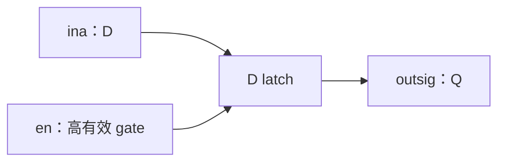
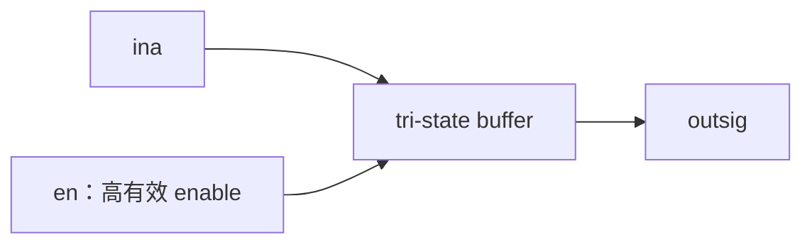

# 2009 數位系統設計期末考：詳解與驗證

題面見 [questions.md](questions.md)。本答案重新推導並核正可辨識的手寫內容；原手寫解不是可直接編譯的規格。所有 RTL、testbench 全文在文末，另有相同的 `.v` 檔供模擬，沒有只有外部連結或不完整核心片段。

## 第 1 題：修正宣告與組合邏輯

錯誤與修正如下：

| 原碼問題 | 修正理由 |
|---|---|
| 將 VeryGood、NotBad 輸入又宣告為 reg | 此處為輸入 wire，不是本模組內要程序寫入的暫存變數 |
| 模組內直接寫 `AndYou = ...` | 這是連續指定，需 `assign`；AndYou 為 wire |
| always 後有兩個敘述卻沒有 begin/end | always 必須包住兩個 IamFine bit 指定 |
| 敏感列表缺 NotBad | NotBad 改變時也應更新輸出；改成 `always @*` |
| 程序指定的輸出型別 | IamFine 宣告為 output reg，完整指定兩個 bit |

AndYou=VeryGood OR NotBad 是兩個逐位 OR gate。IamFine 是兩個獨立單位元 MUX，而不是兩個 2-bit 向量互選：

| Sel | IamFine[1] | IamFine[0] |
|---:|---|---|
| 0 | NotBad[1] | VeryGood[1] |
| 1 | NotBad[0] | VeryGood[0] |

兩個 bit 在每次組合計算都指定，沒有 latch。手寫參考雖修掉部分宣告，仍可能漏 NotBad 敏感性；不能照抄這個遺漏。

## 第 2 題：latch 與 tri-state buffer

以文字呈現的硬體符號（沒有原掃描或圖片）：

```text
       ┌──────────┐
ina ──►│ D      Q │──► outsig
en  ──►│ EN latch │
       └──────────┘

ina ─────────▷────────► outsig
             │
             en
```

上方 EN 是電位使能，不畫時脈邊緣三角標記；下方三角形是非反相緩衝器，使能端無低有效泡泡。

### (a) 高有效、電位敏感 D latch

en=1 時輸出隨 ina 更新；en=0 時沒有指定，保留先前輸出。這是 latch，不是 AND gate，也不是只在邊緣擷取的 D flip-flop。



| en | outsig |
|---:|---|
| 0 | 保持上一個已儲存值；未初始化時可能為 X |
| 1 | ina |

### (b) 高有效 tri-state buffer

en=1 時傳遞 ina；en=0 時明確指定 Z（高阻抗），不是保留上一值。兩條分支都指定，因此沒有上述 latch 的儲存行為。`reg` 在這段只是程序指定變數的宣告，不代表推導出 register。



| en | ina | outsig |
|---:|---:|---|
| 0 | 0 或 1 | Z |
| 1 | 0 | 0 |
| 1 | 1 | 1 |

RTL 以 `assign outsig = en ? ina : 1'bz;` 表示同一功能。三態硬體的實際配置須由目標元件支援，這裡分析的是原題描述的輸出行為。

## 第 3 題：四個 16 位元模組

### (a) MUX21

`assign out = sel ? ina : inb;`，所有輸出位都完整指定，沒有儲存。sel=1 選 ina 的慣例與後續接線一致；原題未定極性，因此須在題解中明示，不能混用另一種慣例。

### (b) DFF16

採 `always @(posedge clk or negedge rst)`，在 `!rst` 時清零，否則用 `Q <= D` 擷取。非阻塞指定模擬同時更新的暫存器，不讓 X 的程序先跑就影響同一邊緣的 Y。

手寫參考出現 negedge rst 卻配 `if(rst)`，極性互相矛盾；本版明確採低有效並修為 `if(!rst)`。重設值零與 rst 極性是補定規則，不是從沒畫出的原波形暗推。

### (c) Shifter

右移為 `{1'b0,C[15:1]}`；左移為 `{C[14:0],1'b0}`。前者丟掉原 bit 0，後者丟掉原 bit 15。資料永遠 16 位，而且完全沒有使用禁止的位移運算符。例：C=16'h8001，右移結果 4000，左移結果 0002；沒有算術右移的符號延伸。

### (d) ALU

case 的四條完整分支依序計算 A+B、A−B、A+16'd1、A−16'd1。用 16 位元輸出自然截去高位，等同 modulo 65536。例如 FFFF+1=0000、0000−1=FFFF。加一、減一與 B 無關，仍須保留 B 作為另外兩種操作的輸入。

default 設為 16'hxxxx，讓未知控制在模擬中顯示未知而非保存舊值；有效 CTR 為二位元的四種確定值，所以普通操作不會走此分支。

## 第 4 題：MyDesign 接線與狀態式

全部內部資料線宣告成 `wire [15:0]`，不是單位元 wire；輸出是 Shifter 的 wire，沒有再以另一個程序重複驅動。每個模組用具名埠避免參數順序弄錯。

令目前狀態為 X、Y，R 為 MyOutput，A 為 ALU 輸入選擇結果：

```text
A = Sel3 ? X : Y
T = ALU(A, MyInput, Mode) modulo 65536
R = LorR ? (T*2 modulo 65536) : floor(T/2)
D_X = Sel1 ? X : R
D_Y = Sel2 ? Y : R
```

低有效 reset 時 X=Y=0；非 reset 的上升緣，同時令 X←D_X、Y←D_Y。回授路徑會經過 DFF，沒有純組合邏輯迴圈。選擇器為保持模式時，輸出仍會隨 MyInput、Mode、LorR 或 Sel3 的組合變化而改變；「保持暫存器」不是「保持 MyOutput」。

## 第 5 題：波形、無 race 驅動與預期結果

tb_waveform 的 clock 初值為 1，之後每 10 ns 反相，符合原圖。初始 reset 低，1 ns 時解除；20/40/60/80 ns 控制和輸入用非阻塞指定，DFF 在該邊緣先取上一段值。檢查延到每段起點後 2 ns，使非阻塞更新與組合邏輯都有時間穩定。

| 檢查時間 (ns) | X | Y | 組合 ALU 計算 | MyOutput |
|---:|---|---|---|---|
| 2 | 0000 | 0000 | 0000+001A=001A，右移 | 000D |
| 22 | 000D | 0000 | 000D+00EA=00F7，右移 | 007B |
| 42 | 000D | 0000 | 0000−0055=FFAB，右移 | 7FD5 |
| 62 | 000D | 7FD5 | 7FD5+1=7FD6，左移 | FFAC |
| 82 | FFAC | FFAC | FFAC−1=FFAB，左移 | FF56 |
| 102 | FF56 | FF56 | FF56−1=FF55，左移 | FEAA |

20 ns 時 X 使用前一段回授 000D，Y 因 Sel2=1 保持零。40 ns 時兩者仍保持；60 ns 時 Y 載入前一段 7FD5；80 ns 時兩者載入 FFAC。100 ns 的最後一個上升緣再載入 FF56；最後一行是原五段結束後的額外確認，不新增第六段刺激。

若在上升緣用 blocking 指定同時修改控制，RTL 與 testbench 的執行順序可能造成 race；原題沒有規定該排程，所以本版使用上述可重現慣例，不聲稱存在唯一未初始化的原始輸出序列。

testbench 只在暫存環境進行數值比較，公開題解以這張簡短文字表呈現必要時序；不產生或提交 VCD、波形圖片、展開測試向量或大型模擬紀錄。

## 驗證與執行

```sh
python tests/test_2009.py
python tests/test_2009.py --model-only
```

以上從儲存庫根目錄執行。第一行實際編譯及執行兩個 testbench；第二行只跑獨立模型。runner 使用 Icarus `-g2012`、`-s tb_units`／`-s tb_waveform` 選擇頂層，所有產物都在暫存目錄，自動刪除。RTL 使用可綜合 Verilog 的基本語法，testbench 的 `$fatal` 提供自動檢查；失敗時回傳非零，不只列出刺激。

Python 標準庫的 6 項測試、135414 個獨立模型檢查，枚舉第 1 題 32 組輸入、全部 65536 個位移輸入的兩方向，與數值／位元組合兩種模型互相核對；驗證 ALU modulo、MUX、latch 保持與三態、MyDesign 五段及最後邊緣。tb_units 另外直接對 RTL 執行 153641 個檢查，涵蓋全數位移值、MUX、四種 ALU、DFF 非同步重設與 2048 次資料路徑擷取。

預設執行必須有 iverilog/vvp，缺工具即失敗，不會把缺少模擬器當作 RTL 通過。可明確指定 `--model-only` 只跑 Python 模型，輸出會註明沒有執行 Verilog；`--require-simulator` 可再次明示 CI 的要求。CI 安裝工具後執行兩支 TB，編譯與模擬產物全部放在自動刪除的暫存目錄。僅通過模型時不能宣稱 RTL 已模擬通過。

## 完整 RTL 與 testbench

<!-- SOLUTION_CODE_BEGIN -->

### `design.v`

```verilog
`timescale 1ns/1ps

module CheerUp(AndYou, IamFine, VeryGood, NotBad, Sel);
    output wire [1:0] AndYou;
    output reg [1:0] IamFine;
    input wire [1:0] VeryGood, NotBad;
    input wire Sel;
    assign AndYou = VeryGood | NotBad;
    always @* begin
        IamFine[0] = Sel ? VeryGood[0] : VeryGood[1];
        IamFine[1] = Sel ? NotBad[0] : NotBad[1];
    end
endmodule

module EnabledLatch(input wire ina, input wire en, output reg outsig);
    always @* begin
        if (en) outsig = ina;
    end
endmodule

module TriStateBuffer(input wire ina, input wire en, output wire outsig);
    assign outsig = en ? ina : 1'bz;
endmodule

// The source does not define selection polarity. We adopt the readable
// reference's convention: sel=1 selects ina, sel=0 selects inb.
module MUX21(input wire [15:0] ina, inb, input wire sel,
             output wire [15:0] out);
    assign out = sel ? ina : inb;
endmodule

// rst is asynchronous and active low. Sequential assignments are nonblocking.
module DFF16(output reg [15:0] Q, input wire [15:0] D,
             input wire clk, rst);
    always @(posedge clk or negedge rst) begin
        if (!rst) Q <= 16'h0000;
        else Q <= D;
    end
endmodule

module Shifter(output wire [15:0] ShOut, input wire [15:0] C,
               input wire LR);
    assign ShOut = LR ? {C[14:0], 1'b0} : {1'b0, C[15:1]};
endmodule

module ALU(output reg [15:0] ALUOut, input wire [15:0] A, B,
           input wire [1:0] CTR);
    always @* begin
        case (CTR)
            2'b00: ALUOut = A + B;
            2'b01: ALUOut = A - B;
            2'b10: ALUOut = A + 16'd1;
            2'b11: ALUOut = A - 16'd1;
            default: ALUOut = 16'hxxxx;
        endcase
    end
endmodule

module MyDesign(input wire Sel1, Sel2, Sel3,
                input wire [1:0] Mode,
                input wire LorR,
                input wire [15:0] MyInput,
                input wire clk, rst,
                output wire [15:0] MyOutput);
    wire [15:0] x, y, dx, dy, operand_a, alu_result;
    MUX21 load_x(.ina(x), .inb(MyOutput), .sel(Sel1), .out(dx));
    MUX21 load_y(.ina(y), .inb(MyOutput), .sel(Sel2), .out(dy));
    DFF16 register_x(.Q(x), .D(dx), .clk(clk), .rst(rst));
    DFF16 register_y(.Q(y), .D(dy), .clk(clk), .rst(rst));
    MUX21 choose_a(.ina(x), .inb(y), .sel(Sel3), .out(operand_a));
    ALU arithmetic(.ALUOut(alu_result), .A(operand_a), .B(MyInput), .CTR(Mode));
    Shifter shift_result(.ShOut(MyOutput), .C(alu_result), .LR(LorR));
endmodule
```

### `tb_units.v`

```verilog
`timescale 1ns/1ps

module tb_units;
    reg [1:0] vg, nb;
    reg select;
    wire [1:0] and_you, fine;
    CheerUp cheer(and_you, fine, vg, nb, select);

    reg ina, en;
    wire latched, tristate;
    EnabledLatch latch_unit(ina, en, latched);
    TriStateBuffer tri_unit(ina, en, tristate);

    reg [15:0] a, b, d;
    reg mux_select, lr, clk, rst;
    reg [1:0] ctr;
    wire [15:0] mux_out, shift_out, alu_out, q;
    MUX21 mux_unit(a, b, mux_select, mux_out);
    Shifter shift_unit(shift_out, a, lr);
    ALU alu_unit(alu_out, a, b, ctr);
    DFF16 dff_unit(q, d, clk, rst);

    reg dxclk, dxrst, s1, s2, s3, dlr;
    reg [1:0] mode;
    reg [15:0] din;
    wire [15:0] dout;
    MyDesign design_unit(s1, s2, s3, mode, dlr, din, dxclk, dxrst, dout);

    integer i, j, k, checked;
    reg [15:0] expected, model_x, model_y, old_output, next_x, next_y;
    reg [1:0] expected_fine;

    function [15:0] model_output;
        input [15:0] x, y, input_value;
        input select_x, left;
        input [1:0] operation;
        reg [15:0] operand, result;
        begin
            operand = select_x ? x : y;
            case (operation)
                0: result = operand + input_value;
                1: result = operand - input_value;
                2: result = operand + 16'd1;
                3: result = operand - 16'd1;
            endcase
            // Test oracle may use shifts; the synthesizable Shifter may not.
            model_output = left ? (result << 1) : (result >> 1);
        end
    endfunction

    initial begin
        checked = 0;
        vg = 0; nb = 0; select = 0;
        ina = 0; en = 0;
        a = 0; b = 0; d = 0; mux_select = 0; lr = 0; ctr = 0;
        clk = 0; rst = 0;
        dxclk = 0; dxrst = 0; s1 = 0; s2 = 0; s3 = 0;
        dlr = 0; mode = 0; din = 0;
        #1;
        if (latched !== 1'bx || tristate !== 1'bz || q !== 16'h0000)
            $fatal(1, "initial latch/tristate/reset mismatch");
        en = 1; ina = 1; #1;
        if (latched !== 1 || tristate !== 1) $fatal(1, "enabled buffer mismatch");
        en = 0; ina = 0; #1;
        if (latched !== 1 || tristate !== 1'bz) $fatal(1, "hold/Z mismatch");
        en = 1; #1;
        if (latched !== 0 || tristate !== 0) $fatal(1, "transparent latch mismatch");
        checked = checked + 4;

        for (i = 0; i < 4; i = i + 1)
            for (j = 0; j < 4; j = j + 1)
                for (k = 0; k < 2; k = k + 1) begin
                    vg = i; nb = j; select = k;
                    expected_fine[0] = (i >> (k ? 0 : 1)) & 1;
                    expected_fine[1] = (j >> (k ? 0 : 1)) & 1;
                    #1;
                    if (and_you !== (vg | nb) || fine !== expected_fine)
                        $fatal(1, "CheerUp mismatch");
                    checked = checked + 1;
                end

        for (i = 0; i < 65536; i = i + 1) begin
            a = i;
            lr = 0; #1;
            expected = i / 2;
            if (shift_out !== expected) $fatal(1, "right shift mismatch %0d", i);
            lr = 1; #1;
            expected = (i * 2) % 65536;
            if (shift_out !== expected) $fatal(1, "left shift mismatch %0d", i);
            checked = checked + 2;
        end

        for (i = 0; i < 1024; i = i + 1) begin
            a = (i * 61) & 65535;
            b = ~a;
            mux_select = 0; #1;
            if (mux_out !== b) $fatal(1, "MUX inb mismatch");
            mux_select = 1; #1;
            if (mux_out !== a) $fatal(1, "MUX ina mismatch");
            checked = checked + 2;
            for (j = 0; j < 4; j = j + 1) begin
                case (j)
                    0: b = 0;
                    1: b = 1;
                    2: b = 16'hffff;
                    3: b = a ^ 16'ha5a5;
                endcase
                for (k = 0; k < 4; k = k + 1) begin
                    ctr = k;
                    case (k)
                        0: expected = a + b;
                        1: expected = a - b;
                        2: expected = a + 16'd1;
                        3: expected = a - 16'd1;
                    endcase
                    #1;
                    if (alu_out !== expected) $fatal(1, "ALU mismatch");
                    checked = checked + 1;
                end
            end
        end

        rst = 1; d = 16'h1234; #1;
        if (q !== 0) $fatal(1, "DFF changed without edge");
        clk = 1; #1;
        if (q !== 16'h1234) $fatal(1, "DFF did not capture on positive edge");
        d = 16'habcd; #1;
        if (q !== 16'h1234) $fatal(1, "DFF transparent while clock high");
        rst = 0; #1;
        if (q !== 0) $fatal(1, "asynchronous reset did not clear immediately");
        rst = 1; clk = 0; #1; clk = 1; #1;
        if (q !== 16'habcd) $fatal(1, "DFF release/capture mismatch");
        checked = checked + 5;

        model_x = 0; model_y = 0;
        dxrst = 1;
        for (i = 0; i < 2048; i = i + 1) begin
            dxclk = 0;
            s1 = i & 1; s2 = (i >> 1) & 1; s3 = (i >> 2) & 1;
            mode = (i >> 3) & 3; dlr = (i >> 5) & 1;
            din = (i * 7919) ^ 16'ha5a5;
            #1;
            old_output = model_output(model_x, model_y, din, s3, dlr, mode);
            if (dout !== old_output) $fatal(1, "datapath before edge mismatch");
            next_x = s1 ? model_x : old_output;
            next_y = s2 ? model_y : old_output;
            dxclk = 1; #1;
            model_x = next_x; model_y = next_y;
            expected = model_output(model_x, model_y, din, s3, dlr, mode);
            if (design_unit.x !== model_x || design_unit.y !== model_y || dout !== expected)
                $fatal(1, "datapath after edge mismatch");
            checked = checked + 2;
        end
        $display("PASS units checks=%0d", checked);
        $finish(0);
    end
endmodule
```

### `tb_waveform.v`

```verilog
`timescale 1ns/1ps

module tb_waveform;
    reg clk, rst, Sel1, Sel2, Sel3, LorR;
    reg [1:0] Mode;
    reg [15:0] MyInput;
    wire [15:0] MyOutput;
    MyDesign dut(.Sel1(Sel1), .Sel2(Sel2), .Sel3(Sel3), .Mode(Mode),
                 .LorR(LorR), .MyInput(MyInput), .clk(clk), .rst(rst),
                 .MyOutput(MyOutput));

    always #10 clk = ~clk;

    initial begin
        clk = 1;
        rst = 0;
        Sel1 = 0;
        Sel2 = 1;
        Sel3 = 1;
        LorR = 0;
        Mode = 2'b00;
        MyInput = 16'h001a;
        #1 rst = 1;
        // Inputs change at the drawn 20 ns boundaries in the NBA region.
        // DFFs therefore sample the old, stable interval without an active race.
        #19 Sel1 <= 1; MyInput <= 16'h00ea;
        #20 Sel2 <= 0; Sel3 <= 0; Mode <= 2'b01; MyInput <= 16'h0055;
        #20 Sel1 <= 0; LorR <= 1; Mode <= 2'b10; MyInput <= 16'h008c;
        #20 Mode <= 2'b11; MyInput <= 16'h00ff;
        #24 $finish(0);
    end

    task check;
        input [15:0] expected_x, expected_y, expected_output;
        begin
            if (dut.x !== expected_x || dut.y !== expected_y ||
                MyOutput !== expected_output)
                $fatal(1, "waveform mismatch at %0t", $time);
            $display("t=%0d X=%04h Y=%04h out=%04h", $time, dut.x, dut.y, MyOutput);
        end
    endtask

    initial begin
        #2 check(16'h0000, 16'h0000, 16'h000d);
        #20 check(16'h000d, 16'h0000, 16'h007b);
        #20 check(16'h000d, 16'h0000, 16'h7fd5);
        #20 check(16'h000d, 16'h7fd5, 16'hffac);
        #20 check(16'hffac, 16'hffac, 16'hff56);
        #20 check(16'hff56, 16'hff56, 16'hfeaa);
        $display("PASS waveform rows=6");
    end
endmodule
```

<!-- SOLUTION_CODE_END -->
