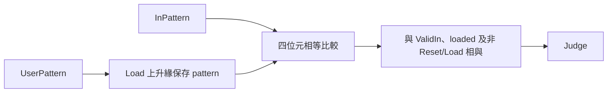

# 2022 期末考詳解

本頁解答對應 [七道完整題目](questions.md)，並直接附全部 Verilog。文字規格、埠與圖示可核對；原卷沒有指定的初始化、衝突處理與重新載入行為在此明示，避免把本版決策混成原題要求。

## Q1：0 是 reset 狀態，1–1023 是計數循環

原圖 Reset 高時輸出 0，因此使用 `always @(posedge Clk or posedge Reset)`，Reset 具有最高優先權。En=0 不賦值，觸發器自然保持。En=1 時，1023 跳回 1，其餘值加 1；Reset 後從 0 加到 1。若直接使用 10-bit 溢位，1023 會變 0，與題目不符。

| 目前值 | Reset | En | 更新後 |
|---|---|---|---|
| 任意 | 1 | 任意 | 0（立即） |
| 0 | 0 | 1 | 1 |
| 1022 | 0 | 1 | 1023 |
| 1023 | 0 | 1 | 1 |
| k | 0 | 0 | k |

## Q2：左旋是位元重排

令輸入為 `{a,b,c,d}`，四種輸出依序為 `{a,b,c,d}`、`{b,c,d,a}`、`{c,d,a,b}`、`{d,a,b,c}`。這是組合邏輯，不需 Clk。使用 case 完整列出四種情況，沒有 latch。例 `RIn=1001` 的結果是 `1001,0011,0110,1100`。

## Q3：同步讀寫與 read-first

宣告 `reg [9:0] mem[0:7]`。每個上升緣用 nonblocking assignment 更新 Q，WE=1 時更新 mem[Add]。兩個右側皆在該緣讀舊狀態，所以同一個位址邊讀邊寫時，Q 取得舊 word，mem 保存新 D。下一拍才讀到新資料。這是本版明示的 **read-first**；原題只要求同步讀寫，没有指定衝突選項。

未寫過的 word 在模擬為 X，不能假定為 0；本模組沒有 reset 埠，測試先寫入再核對。不要把 `assign Q=mem[Add]` 的非同步讀誤當同步讀。

## Q4：保存設定，組合比對

Load=1 的上升緣保存 UserPattern，並設 loaded。輸出為 `!Reset && !Load && loaded && ValidIn && (InPattern==pattern)`。UserPattern 在 Load=0 時改變不影響已保存圖樣。Judge 是目前圖樣的組合結果，与原圖「輸入 p 區間即有效」相符；若另用 `Judge<=...`，將可能增加一拍延遲。

Reset 高時清除設定與 loaded，使尚未載入前不会把零誤報為匹配。Load 優先於有效資料，本版不在載入期間接受比對。設定寄存器和資料比對路徑可以畫成：



## Q5：遮罩不比較無關位元

先算 XOR，每個 1 表示該 bit 不同；與 mask 做 AND，移除不需比較的位置。結果為 0 即所有必要 bit 都相同：`((InPattern ^ pattern) & mask)==0`。Mask=0000 時，任何**有效且已載入**的四位元資料都匹配；ValidIn=0 仍不得匹配。Mask 在 Load 邊緣与圖樣一起保存。

對 pattern=1001、mask=1101，必要 bit 是最高兩位及最低位，第三個顯示位不重要，所以僅有 1001、1011 兩個二元輸入匹配。bit 編號為 [3:0]，被忽略的是 bit1。

## Q6：同拍寫入新累計值

維持 10-bit count 並重用 PatternCheck。每次有效匹配的上升緣，同時把 `count+1` 存回 count 與 U1 位址 4。若把 D 接 count，RegisterFile 會讀到該緣更新前的舊 count，結果少一次。nonblocking assignment 不是依文字先後即時更新，要明確用 next_count。

Reset 立即清零 count；Load 邊緣開始新序列並清零位址 4。只要匹配就寫新的累計值，没有匹配時保持結果。合法序列最多 1022 筆，10 bits 足夠表示次數。原題没有輸出埠，不額外改介面。

RegisterFile 沒有非同步 reset：Reset 高時**下一個時脈上升緣**才把指定 word 寫成 0，因此測試將 Reset 維持跨過至少一個上升緣，或透過 Load 初始化新序列。count 本身仍是非同步歸零。這是分清控制狀態和記憶體初始化的重要差別，不能宣稱沒有 reset 的 SRAM word 會立即清零。

例載入 3，資料 `3,4,3,3`，ValidIn=`1,1,0,1`，位址 4 的結果依序 `1,1,1,2`；無效的第三筆不計。

## Q7：位置也要寫 next_index

每個 ValidIn=1 的上升緣先接受一筆有效資料，其順位為 `index+1`；若固定遮罩匹配，將同一個 next_index 存入 U1 位址 7。沒有匹配則保留先前位置，而有效順位仍前進。ValidIn=0 兩者皆不更新。

Reset 清除 index，並在 Reset 高的下一個上升緣將位址 7 寫 0。此補定使沒有任何匹配時結果可辨識為 0，並使測試可重複。例資料 `1001,0000,1101,1001` 的 ValidIn=`1,0,1,1`，有效順位依序 `1,–,2,3`，固定圖樣 `1?01` 三筆皆相符，結果為 3。

## 題面未指定的邊界與工具

- Reset 高有效是由波形判定；載入與計數採上升緣，Judge/Match 是同區間組合輸出。
- 讀寫衝突採 read-first；未寫 RF 的內容不做任意初始化。
- Load 開始新計數序列；Reset／Load 優先於資料。Mask 同 Load 保存。
- 位置採有效資料順位；無匹配結果為 0。原介面沒有輸出埠，結果可從 U1 檢查。
- `Rout` 拼字、多餘括號已依原 module 介面修正；全部原始碼集中在 design.v，沒有個人檔名。

`tests/test_2022.py` 用獨立 Python 模型產生 HDL 自動驗證：四位元旋轉全部 64 組、全部 256 組完全比對、全部 4096 組 mask 比對、1023 回捲與停用保持、同步記憶體碰撞、無效資料與重新載入、最大合法序列。模擬以 Icarus Verilog 執行，CI 失敗會阻止通過；Python 本身不是硬體答案。

## 完整 Verilog 參考程式

<!-- SOLUTION_CODE_BEGIN -->

### `design.v`

```verilog
`timescale 1ns/1ps
// 2022 Q1: high-active asynchronous reset, enabled modulo-1023 counter.
module EnCounter(CounterOut, Clk, Reset, En);
    output reg [9:0] CounterOut;
    input Clk, Reset, En;
    always @(posedge Clk or posedge Reset) begin
        if (Reset) CounterOut <= 10'd0;
        else if (En) begin
            if (CounterOut == 10'd1023) CounterOut <= 10'd1;
            else CounterOut <= CounterOut + 10'd1;
        end
    end
endmodule

// Q2: keep the port spelling Rout from the printed module declaration.
module Rotator(Rout, RIn, Rb);
    output reg [3:0] Rout;
    input [3:0] RIn;
    input [1:0] Rb;
    always @(*) begin
        case (Rb)
            2'd0: Rout = RIn;
            2'd1: Rout = {RIn[2:0], RIn[3]};
            2'd2: Rout = {RIn[1:0], RIn[3:2]};
            2'd3: Rout = {RIn[0], RIn[3:1]};
            default: Rout = 4'bxxxx;
        endcase
    end
endmodule

// Q3: synchronous read-first behavior on a read/write collision.
module RegisterFile(Q, D, Clk, WE, Add);
    output reg [9:0] Q;
    input [9:0] D;
    input Clk, WE;
    input [2:0] Add;
    reg [9:0] mem [0:7];
    always @(posedge Clk) begin
        Q <= mem[Add];
        if (WE) mem[Add] <= D;
    end
endmodule

// Q4: register the user pattern, compare the current input without another cycle delay.
module PatternCheck(Judge, InPattern, ValidIn, UserPattern, Load, Clk, Reset);
    output Judge;
    input [3:0] InPattern, UserPattern;
    input ValidIn, Load, Clk, Reset;
    reg [3:0] pattern;
    reg loaded;
    always @(posedge Clk or posedge Reset) begin
        if (Reset) begin pattern <= 4'd0; loaded <= 1'b0; end
        else if (Load) begin pattern <= UserPattern; loaded <= 1'b1; end
    end
    assign Judge = !Reset && !Load && loaded && ValidIn && (InPattern == pattern);
endmodule

// Q5: a mask bit of 1 requires equality; a mask bit of 0 ignores that bit.
module MaskPatternCheck(Match, InPattern, ValidIn, Mask, UserPattern, Load, Clk, Reset);
    output Match;
    input [3:0] InPattern, Mask, UserPattern;
    input ValidIn, Load, Clk, Reset;
    reg [3:0] pattern, mask;
    reg loaded;
    always @(posedge Clk or posedge Reset) begin
        if (Reset) begin pattern <= 4'd0; mask <= 4'd0; loaded <= 1'b0; end
        else if (Load) begin pattern <= UserPattern; mask <= Mask; loaded <= 1'b1; end
    end
    assign Match = !Reset && !Load && loaded && ValidIn && (((InPattern ^ pattern) & mask) == 4'd0);
endmodule

// Q6: no output port was supplied; the specified result is U1.mem[4].
module PatternCount(InPattern, ValidIn, UserPattern, Load, Clk, Reset);
    input [3:0] InPattern, UserPattern;
    input ValidIn, Load, Clk, Reset;
    reg [9:0] count;
    wire match;
    wire [9:0] readback;
    wire [9:0] next_count = count + 10'd1;
    PatternCheck U2(.Judge(match), .InPattern(InPattern), .ValidIn(ValidIn),
                    .UserPattern(UserPattern), .Load(Load), .Clk(Clk), .Reset(Reset));
    always @(posedge Clk or posedge Reset) begin
        if (Reset) count <= 10'd0;
        else if (Load) count <= 10'd0;
        else if (match) count <= next_count;
    end
    RegisterFile U1(.Q(readback), .D((Reset || Load) ? 10'd0 : next_count),
                    .Clk(Clk), .WE(Reset || Load || match), .Add(3'd4));
endmodule

// Q7: count only valid items; save the last rank of a 1?01 item to U1.mem[7].
module PatternPosition(InPattern, ValidIn, Clk, Reset);
    input [3:0] InPattern;
    input ValidIn, Clk, Reset;
    reg [9:0] index;
    wire [9:0] readback;
    wire [9:0] next_index = index + 10'd1;
    wire match = (((InPattern ^ 4'b1001) & 4'b1011) == 4'd0);
    always @(posedge Clk or posedge Reset) begin
        if (Reset) index <= 10'd0;
        else if (ValidIn) index <= next_index;
    end
    RegisterFile U1(.Q(readback), .D(Reset ? 10'd0 : next_index), .Clk(Clk),
                    .WE(Reset || (ValidIn && match)), .Add(3'd7));
endmodule
```

### `tb.v`

```verilog
`timescale 1ns/1ps
// Small executable example; exhaustive independent checks are in tests/test_2022.py.
module tb_2022;
    reg Clk=0, Reset=0, Load=0, ValidIn=0;
    reg [3:0] InPattern=0, UserPattern=0;
    wire Judge;
    PatternCheck DUT(Judge,InPattern,ValidIn,UserPattern,Load,Clk,Reset);
    PatternCount Count(InPattern,ValidIn,UserPattern,Load,Clk,Reset);
    always #5 Clk=~Clk;
    initial begin
        #1; Reset=1;
        #5; Reset=0;
        @(negedge Clk); Load=1; UserPattern=3;
        @(negedge Clk); Load=0; ValidIn=1; InPattern=3;
        #1; if(Judge !== 1'b1) $fatal(1,"same-interval comparison failed");
        @(negedge Clk); if(Count.U1.mem[4] !== 10'd1) $fatal(1,"count must include first item");
        InPattern=4;
        @(negedge Clk); InPattern=3; ValidIn=0;
        @(negedge Clk); ValidIn=1;
        @(negedge Clk); ValidIn=0;
        if(Count.U1.mem[4] !== 10'd2) $fatal(1,"invalid input counted or final update lost");
        $display("PASS 2022 example: U1.mem[4]=2");
        $finish(0);
    end
endmodule
```

<!-- SOLUTION_CODE_END -->
